<div align=center>
 
</div>

<div align=center>
 
</div>

<!-- waka-box start -->
#### <a href="https://gist.github.com/ddee6660ea4819d749c4393b4cc8e382" target="_blank">📊 Weekly development breakdown</a>
```text
Vue         🕓 3h10m █████████▎░░░░░░░░░░░░░░░░░ 34.3%
TOML        🕓 1h47m █████▏░░░░░░░░░░░░░░░░░░░░░ 19.3%
TypeScript  🕓 1h5m  ███▏░░░░░░░░░░░░░░░░░░░░░░░ 11.8%
Markdown    🕓 43m   ██▏░░░░░░░░░░░░░░░░░░░░░░░░  7.9%
Less        🕓 26m   █▎░░░░░░░░░░░░░░░░░░░░░░░░░  4.8%
```
<!-- Powered by https://github.com/YouEclipse/waka-box-go . -->
<!-- waka-box end -->

<div align=center>
 <kbd> </kbd>
</div>
