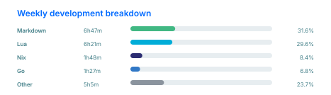

# Hi, I'm aevre.

Keep building. Keep learning.

## Technology

| Area     | Technologies                                          |
| -------- | ----------------------------------------------------- |
| Backend  | Go · PostgreSQL · Redis                               |
| Frontend | TypeScript · Vue · Nuxt · React · Vite · Pinia · Less |
| Tooling  | Neovim · Lua · Git                                    |

## Activity

  
   
  
  

<!-- waka-box start -->

<a href="https://gist.github.com/ddee6660ea4819d749c4393b4cc8e382">
  <picture>
    <source media="(prefers-color-scheme: dark)" srcset="./profile/wakatime-dark.svg" />
    <source media="(prefers-color-scheme: light)" srcset="./profile/wakatime.svg" />
    
  </picture>
</a>

<!-- Powered by https://github.com/abordage/wakatime-box . -->
<!-- waka-box end -->

<picture>
  <source media="(prefers-color-scheme: dark)" srcset="./assets/github-contribution-grid-snake-dark.svg" />
  <source media="(prefers-color-scheme: light)" srcset="./assets/github-contribution-grid-snake.svg" />
  
</picture>
